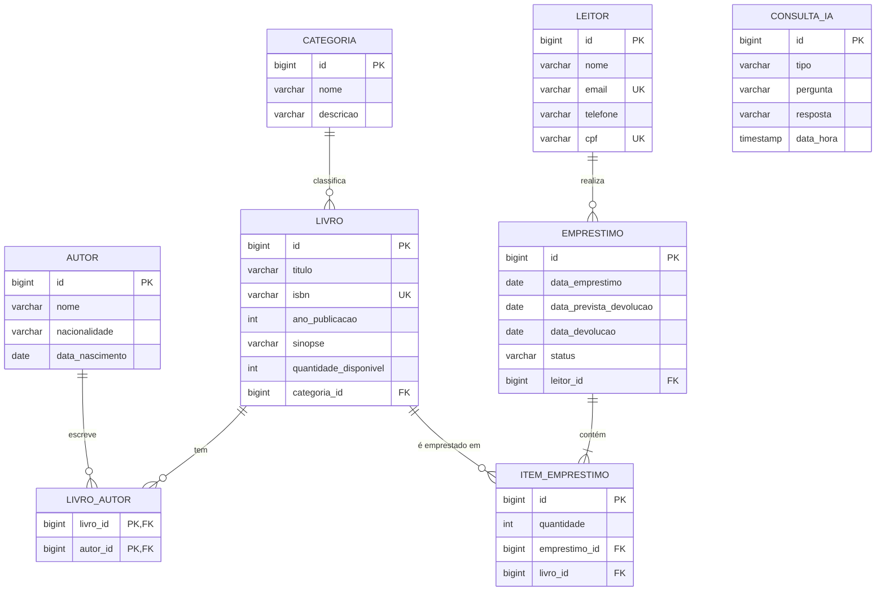

# 📚 Biblioteca Comunitária com IA (Spring AI)

Sistema web de biblioteca com funcionalidades de IA generativa, desenvolvido com Spring Boot, Spring MVC, Thymeleaf, Spring Data JPA e **Spring AI**.

## Funcionalidades de IA (GenAI)

| Funcionalidade | Onde usar | O que faz |
|---|---|---|
| **Gerar sinopse** | Livros > Novo/Editar > botão "✨ Gerar sinopse com IA" | A IA escreve a sinopse a partir do título, autores e categoria. O texto é salvo no livro. |
| **Assistente do bibliotecário** | Menu "✨ Assistente IA" | Responde perguntas usando o acervo cadastrado no banco como contexto. |
| **Recomendação para o leitor** | Leitores > "✨ Recomendar" | Sugere livros do acervo com base no histórico de empréstimos do leitor. |
| **Histórico** | Menu "Histórico IA" | Lista as últimas consultas à IA, salvas no banco de dados. |

Além disso, o sistema mantém os CRUDs de Categorias, Autores, Livros, Leitores e Empréstimos.

## Tecnologias
- Java 17, Spring Boot 3.5, Spring MVC, Spring Data JPA, Thymeleaf
- **Spring AI 1.1** (`ChatClient`, starter OpenAI-compatível)
- Banco de dados relacional H2 (arquivo local). Pode trocar por MySQL/PostgreSQL.
- HTML, CSS e JavaScript (`fetch` para gerar a sinopse sem recarregar a página)

## Arquitetura MVC
- **Model:** Entity, Repository e Service (o `IAService` concentra o uso do Spring AI)
- **Controller:** Controllers (acessam apenas Services)
- **View:** Templates Thymeleaf

## Como executar

1. Tenha o **JDK 17+** instalado.
2. Na pasta do projeto, copie `secrets.properties.example` para **`secrets.properties`** e coloque sua chave:
   ```properties
   AI_API_KEY=sua_chave_aqui
   ```
   Para usar outro provedor (Groq, Gemini...), veja os exemplos dentro do próprio arquivo.
3. Execute a classe `BibliotecaApplication` (ou `./mvnw spring-boot:run`, se tiver o Maven).
4. Acesse http://localhost:8080

> ⚠️ **A chave da API não está no repositório.** O arquivo `secrets.properties` está no `.gitignore` e nunca deve ser enviado ao GitHub. Também é possível usar a variável de ambiente `AI_API_KEY`.

Ordem sugerida para testar: Categoria → Autor → Livro (quantidade > 0) → Leitor → Empréstimo → Assistente IA.

## Diagrama MER


